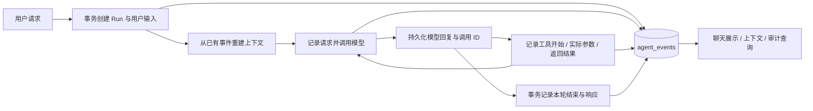

# 从聊天记录到可重建的执行记录

本实现借鉴 [DeepSeek Harness 的会话事件模型](https://github.com/deepseek-ai/deepseek-harness/blob/master/docs/subsystems/session.zh.md)：持久事实按序追加，模型上下文与界面消息从事实派生。当前改造覆盖教学主助手的每轮执行；已有 RPA 任务和批改任务继续通过各自的任务 ID 查询真实业务状态。

## 已实现的行为

- 每轮用户请求分配独立的 `run_id`，在会话内分配单调递增的 `turn`；每条事件有版本号、唯一 ID、轮内连续的 `seq`、类型、JSON 载荷和创建时间。
- 用户输入、模型请求及回复、工具开始及返回、实际执行参数、Skill 正文与版本、模型 usage 和结束原因、失败与中断均进入记录。
- 下一轮从记录恢复 `user`、`assistant`、`tool` 消息及调用 ID，当前问题只进入一次。系统提示和工具定义每次按当前用户权限构造，实际发给模型的请求另行完整保存。
- 聊天界面的“执行记录”可查看事件与分页、重建上下文；界面消息也可从事件重新派生。Redis 或兼容的 `chat_messages` 投影丢失后，已有执行记录仍可用于继续会话。
- 同一用户使用同一 `Idempotency-Key` 重试，会返回原执行；完成的轮次返回已保存响应。已运行、失败或中断的请求返回已有执行 ID，不会自动重跑。

## 代码路径

| 位置 | 职责 |
| --- | --- |
| `backend-go/internal/models/agent_execution.go` | `agent_runs` 生命周期索引与 `agent_events` 事件模型。 |
| `backend-go/internal/execution/store.go` | 事务接纳请求、事件序号、完成与失败、历史选择、所有权检查。 |
| `backend-go/internal/execution/project.go` | 纯函数重建模型消息，检测序号缺口、版本与工具配对。 |
| `backend-go/internal/execution/display.go` | 从事件恢复聊天展示，兼容尚未进入新执行链路的旧会话。 |
| `backend-go/internal/agent/einoruntime/runtime.go` | 在真实模型与工具调用边界记录事实，支持结构化历史输入。 |
| `backend-go/internal/agent/gateway.go` | 记录服务端绑定后的参数、调用 ID、Skill 版本和缓存命中；业务权限仍由网关校验。 |
| `backend-go/internal/handlers/agent_handler.go` | 将 HTTP 请求与一次持久执行绑定，返回 `run_id` 和业务任务信息。 |
| `backend-go/internal/handlers/execution_handler.go` | 只读执行查询、事件分页与上下文重建接口。 |
| `vue-grading-frontend/src/components/ExecutionHistory.vue` | 会话执行记录窗口。 |



## 持久化与并发约束

`Begin` 在同一事务内锁定会话，检查所有权及已有活跃轮次，创建执行、初始事件和兼容聊天投影。`Finish` 原子提交结束事件、执行状态、HTTP 响应和助手展示消息。事件追加采用会话 → 执行的固定锁定顺序，并用 `(run_id, sequence)` 唯一索引保证顺序。

模型请求前、工具执行前必须成功记录；记录写入失败会阻止后续模型与工具调用。工具执行后的结果写入失败会保留不完整记录，并向用户提示核对任务。记录包含 `job_id` 的工具回执，但“本轮完成”仅表示助手这一轮结束，不能据此判断下载、解压或批改已完成。

每次事件追加续期 10 分钟。活跃轮次未过期时，同一会话的另一条消息返回 409。若进程崩溃，下一条新请求在租约过期后把旧轮次标记为 `INTERRUPTED`；旧执行随后不能再追加或完成。记录租约不替代外部任务的幂等机制。

当工具调用没有对应结果，重建会派生一个明确标记 `outcome: unknown`、`source: reconstruction` 的消息以闭合模型协议，并列出未解决调用。这个派生消息不会写回事实日志，也不会触发工具。用户应通过已记录任务 ID 查询或核对后续处理，不能从缺失结果推断操作成功或失败。

## 上下文范围与兼容

- 每次模型输入保留最近 9 个完整历史轮次，再加入当前用户输入。窗口按轮次切分，保留工具请求和返回的配对；完整事件仍持续保存在数据库。当前版本尚未进行摘要压缩。
- 首次接入旧会话时，将最近 20 条旧展示消息按原角色、顺序与时间导入一次 `history.imported`。历史工具细节无法补造；原聊天表保留。
- `model.request` 保存每一步当时实际组装的完整消息、工具定义与模型参数；重建接口返回该轮最近的请求快照。重建不会再次向模型发送请求，因此不能保证重新采样出相同答案。
- Skill 的历史正文与版本用于解释当时的行为；新轮次重新按现有角色加载 Skill，不把历史加载状态当成当前权限。
- 原 `/api/agent/chat` 的 `reply`、`action`、`session_id`、任务字段继续保留，额外返回 `run_id`。原 `/history` 仍返回展示消息数组。
- 事件载荷可能包含用户输入、工具结果和系统提示，读取始终要求会话属于当前用户；不会保存模型 API Key 或认证请求头。用户删除会话时，在同一事务删除执行、事件及兼容消息；仍在执行的会话拒绝删除。

## 只读接口

| 接口 | 返回内容 |
| --- | --- |
| `GET /api/sessions/:session_id/runs` | 最近 20 个执行，含轮次、状态、最后事件序号与租约时间。 |
| `GET /api/sessions/:session_id/runs/:run_id?after_seq=0&limit=50` | 稳定事件序号分页，返回 `next_seq` 与 `has_more`；单页最多 200 条。 |
| `GET /api/sessions/:session_id/runs/:run_id/context` | 该轮及前 9 轮的上下文、未解决调用、该轮最后模型请求快照。 |

启动新版本 Go 服务时，现有 GORM 初始化会新增 `agent_runs` 与 `agent_events` 两张表。原业务表不删除、不重命名；旧数据按首次实际对话逐步接入。

## 验证

纯单元测试和现有回归测试：

```bash
cd backend-go
go test ./...
go vet ./...
```

真实 MySQL 事务、请求幂等、并发序号、租约中断、权限和 HTTP 兼容测试使用独立数据库：

```bash
export EXECUTION_TEST_DSN='测试用户:测试密码@tcp(127.0.0.1:3306)/rpa_test_execution_自定义后缀?charset=utf8mb4&parseTime=True&loc=Local'
go test -p 1 ./internal/execution ./internal/agent ./internal/handlers -count=1
```

测试只接受名称包含 `rpa_test_execution_` 的专用数据库；不设置变量时集成用例跳过。浏览器测试只使用拦截的 fixture API，不会创建真实任务或调用模型：

```bash
RPA_UI_BASE_URL=http://127.0.0.1:6017 python vue-grading-frontend/tests/execution_history_smoke.py
```
