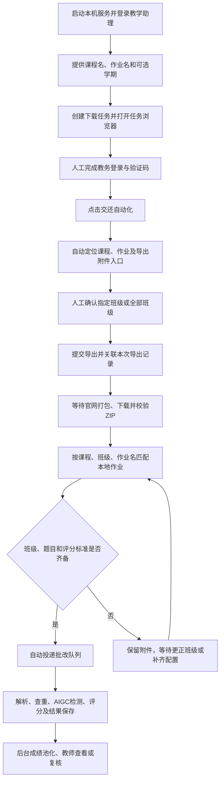

# 教务作业拉取与接续批改流程

2026-10-18 更新：拉取、解压整理和批改现已分开。默认下载并整理后停止，只有明确选择完整流程才接续批改；网页上传也仅导入材料。当前接口、工具、目录和恢复方式以 [作业材料工作流](docs/homework-materials-workflow.md) 为准，下文保留此前官网导航说明。

整理日期：2026-10-14。依据当前项目代码、前端按钮和任务控制逻辑整理。
当前目标为西电教学平台，流程采用人工登录和确认范围、系统自动导航和下载、按本地配置接续批改。

## 1. 总体流程



遇到课程或页面歧义、登录过期、无法关联导出记录时，任务会交给人工操作，处理后再继续。

## 2. 用户实际操作

### 第一步：启动并准备

双击项目根目录的 `start.bat`，打开 `http://127.0.0.1:6006`，使用教师或管理员身份登录本地教学助理。

准备官网中的准确课程名称、作业名称；同名课程可补充学期。
若希望下载后直接批改，可先在「作业管理」准备对应的课程、班级、作业名称、题目要求和 JSON 评分标准。

### 第二步：发起任务

两个入口均可使用：

- 在「AI 教学助手」选择「从教务系统下载作业并批改」，再提供课程与作业名称。
- 打开「作业控制台」，填写课程名称、作业名称及可选学期，点击「启动抓取」。

对话示例：

> 请下载“操作系统”课程的“实验一”作业附件，学期为“2026秋季”，下载后按已配置的标准批改。

主助手提取目标后创建任务，返回任务 ID。右侧控制台自动打开并选中该任务；创建成功表示已接受请求。

### 第三步：人工登录教务平台

系统为任务启动独立 Chromium 会话，在控制台中显示可操作的浏览器画面。
在该画面内输入教务账号、密码，完成验证码或其他身份验证，并返回教学平台。

控制台会检查登录状态，登录成功后显示「已登录，等待继续」。此时点击 **「交还自动化」**。
登录成功后仍保持人工控制，直到明确交还控制权。

教务密码和验证码只在任务浏览器中输入。聊天中只需提供课程、作业及学期信息。

### 第四步：自动定位目标作业

Worker 先获取各标签页及 iframe 的基础信息：标题、URL 路径、标题层级、导航分区、
控件角色、可访问名称、局部上下文、搜索入口及页面滚动情况，也支持开放 Shadow DOM 组件中的控件。
页面 Agent 加载完整导航 Skill，先判断当前页面已经完成哪些业务步骤，再选择下一步。

Skill 给出的业务目标顺序为：

**门户 → 个人空间 → 目标课程 → 作业菜单 → 指定作业的批阅入口 → 更多 → 导出作业附件。**

该顺序是业务流程，实际点击入口依据当前页面语义确定，例如课程卡片的“进入课程”、
作业记录的“批阅”或“查看提交”、导出设置的“导出附件”。定位支持标准标签及 ARIA 控件，
不要求课程卡片必须带 `cname`，也不要求作业标题必须位于 `li > h2` 或导出按钮位于 `morePop`。

每次动作后重新获取页面基础信息，再按 Skill 更新流程判断。页面较大时优先保留目标相关
控件，并标记观察截断；Agent 可搜索、滚动或切换页面继续定位。
同名课程、目标缺乏核验依据或连续操作没有进展时，会请求人工协助。
可以「暂停并接管」，手动进入目标页面；需要时核对并点击「确认当前作业并继续」，随后交还自动化。

### 第五步：确认班级范围

系统识别导出设置中的班级选项，控制台显示「确认本次导出班级」。
明确选择指定班级，或在平台提供该选项时选择全部班级，然后点击 **「确认范围并继续」**。

系统会应用选择并读回核验，班级确认成功后继续执行；不会自行默认导出全部班级。

### 第六步：导出、关联记录并等待打包

控制器先保存已有导出记录及本次提交意图，再提交官网导出。
随后进入下载中心，只跟踪与本次提交关联的记录，并等待平台打包完成。

如果无法可靠判断哪些记录属于本次导出，会显示 **「请核对并选择本次导出的全部记录」**。
在控制台勾选正确记录，点击 **「确认记录并继续」**。导出已经提交时不要重复提交，系统会保留该检查点。

### 第七步：自动下载并校验

导出记录可下载后，系统保存临时文件，并检查：

- 文件存在且大小不为零。
- ZIP 可正常打开且包含条目。
- ZIP 内部 CRC 校验通过。
- 计算 SHA-256，用于记录附件身份。

校验通过后将临时文件原子保存为最终文件，并在任务中记录附件路径、大小和哈希。
当前默认保存到：

```text
D:\dzq\LLM_TEACH_ASSISTANT\downloads\<任务ID>\
```

该目录可通过 `RPA_DOWNLOAD_DIR` 改配。浏览器临时文件也位于相应任务目录中。

### 第八步：匹配本地作业并接续批改

下载结束后，Go 将通过校验的文件登记为附件，按 **课程名称 + 班级名称 + 作业名称** 匹配本地作业。
当前学期字段辅助官网导航，本地作业匹配使用上述三项。

| 情况 | 系统行为 | 用户需要做的事 |
| --- | --- | --- |
| 已有对应作业，题目和评分标准齐备 | 自动创建并投递批改任务 | 查看批改进度和结果 |
| 未找到对应作业 | 自动创建待配置的作业记录 | 在作业管理填写题目要求及 JSON 评分标准 |
| 已有作业，但题目或评分标准缺失 | 保留附件，显示等待配置 | 补齐并保存配置 |
| 附件班级无法确认或名称不匹配 | 等待班级映射 | 在控制台「核对或更正班级」，输入准确名称并点击「关联班级」 |

配置补齐后，调度器会自动检查并继续，无需重新下载附件。

批改阶段沿用已有流程：拆解 ZIP、解析学生文件、查重、AIGC 检测、代码与文档匹配分析、DeepSeek 评分、保存结果。
主批改完成后，成绩池化另起后台任务。结果保存在本地项目数据库中，教师可进入「查看作业」查看结果、复核及导出成绩。

## 3. 状态如何判断

下载任务与附件批改任务分别记录状态。

| 状态 | 含义 |
| --- | --- |
| `QUEUED` | 下载任务已创建，等待打开浏览器 |
| `RUNNING` | 自动导航、导出或下载正在进行 |
| `WAITING_USER` | 等待人工登录、确认班级、核对记录或接管页面 |
| `SUCCEEDED` | 本次关联的附件已全部下载并通过校验 |
| `PARTIAL_SUCCESS` | 部分附件成功，仍有附件失败 |
| `INTERRUPTED` | 浏览器会话中断或超时，需要重新登录并重试 |
| `WAITING_RUBRIC` | 附件已登记，等待班级确认、题目或评分标准 |
| `PUBLISHED` / `PENDING` / `PROCESSING` | 批改已投递、等待执行或正在执行 |
| `SUCCESS` | 主批改完成；成绩池化可能仍在后台运行 |
| `FAILED` / `CANCELLED` | 对应任务失败或被取消，查看任务说明 |

## 4. 暂停、断线和重试

- 「暂停并接管」将浏览器交给用户；操作结束后点击「交还自动化」。正在传输的文件可能继续下载。
- 收起控制台或刷新页面不会主动取消后台任务，重新打开时会查询本人任务状态。
- Worker 重启后未结束任务会转为 `INTERRUPTED`。浏览器 Cookie 不持久化，需要重新登录。
- 「重新登录并重试，保留成功附件」会保留已校验文件及导出检查点；已提交导出的任务先恢复下载中心记录。
- 当前人工控制连续约 15 分钟无操作，或单次浏览器会话超过 2 小时，会被关闭并标记中断。
- 平台打包超过 15 分钟会请求人工检查；文件传输停滞约 120 秒或超过 30 分钟会判为下载失败。

## 5. 后台模块分工

| 模块 | 职责 |
| --- | --- |
| Vue 控制台 | 展示本人任务、浏览器画面、人工输入、班级和记录确认、附件批改进度 |
| Go 主助手 / `download-homework` Skill | 理解下载请求，创建和查询任务，响应暂停、恢复、取消指令 |
| Go/Eino 页面 Agent / `fetch-homework` Skill | 根据当前控件观察选择下一步导航动作 |
| Python RPA Worker / Playwright | 执行浏览器动作，管理控制权，提交导出、下载并校验文件 |
| Go 调度器 | 镜像状态、重试派发、导入附件、匹配作业、检查配置并投递批改 |
| Kafka | 分别派发抓取任务和作业批改任务；人工等待由持久任务处理 |
| MySQL | 保存抓取任务、附件记录、本地作业、批改任务与成绩 |
| Python AI gRPC 服务 | 查重、AIGC 检测、匹配分析和云端评分等计算能力 |

页面决策由 Go/Eino 执行；RPA Worker 专注浏览器与文件操作，不加载批改模型。
下载任务和浏览器操作均校验登录用户、教师或管理员角色及任务创建者。

## 6. 代码定位与验证范围

- 前端入口：[RpaTaskPanel.vue](vue-grading-frontend/src/components/RpaTaskPanel.vue)、[RpaBrowserPanel.vue](vue-grading-frontend/src/components/RpaBrowserPanel.vue)。
- 对话工具：[tool_fetch_homework.go](backend-go/internal/agent/tool_fetch_homework.go)。
- 调度与配置门控：[service.go](backend-go/internal/rpa/service.go)。
- 浏览器和导出控制：[task_controller.py](ai_engine_python/app/rpa/task_controller.py)。
- 下载校验：[download_manager.py](ai_engine_python/app/rpa/download_manager.py)。
- 页面基础信息：[page_snapshot.py](ai_engine_python/app/rpa/page_snapshot.py)。
- 详细实现说明：[rpa-implementation.md](docs/rpa-implementation.md)。

此前本机部署验收覆盖真实 Chromium 上的模拟站点行为，以及实际模型与云端批改链路。
真实教师账号登录后的课程列表、班级控件和官网导出下载，需要结合实际账户继续端到端验收。
